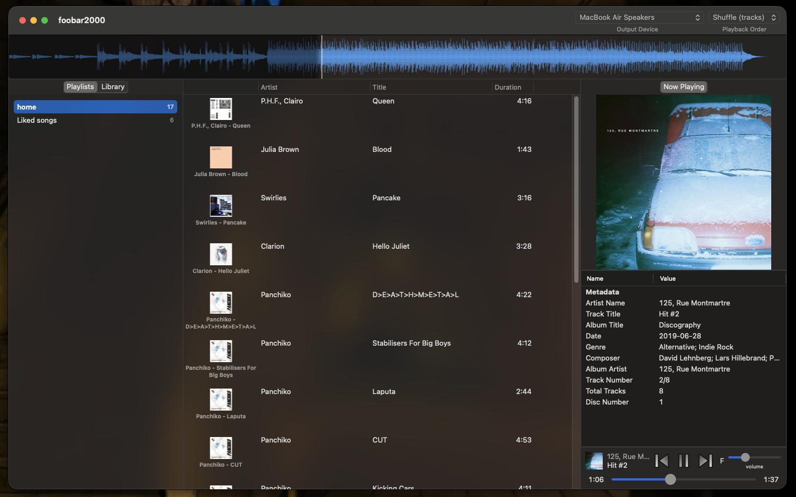

# foobar2000-cfg

My foobar2000 v2.26 for Mac setup (`~/Library/foobar2000-v2/`).



Bundled components include Playlist Organizer, SimPlaylist, and Waveform Seekbar. [Source](https://github.com/JendaT/fb2k-components-mac-suite) · [MIT license](docs/components-LICENSE.txt)

## Restore

Quit foobar2000, then:

```sh
gh repo clone drugdamage/foobar2000-cfg ~/foobar2000-cfg-backup
rsync -a --exclude .git --exclude .gitignore --exclude README.md --exclude docs/ \
  ~/foobar2000-cfg-backup/ ~/Library/foobar2000-v2/
```

Music is expected in `~/dd/Songs`; elsewhere, re-add it in Preferences → Media Library.

## Update

```sh
rsync -a --delete --exclude .git --exclude .gitignore --exclude README.md --exclude docs/ \
  ~/Library/foobar2000-v2/ ~/foobar2000-cfg-backup/
cd ~/foobar2000-cfg-backup && git add -A && git commit -m "Update config" && git push
```
